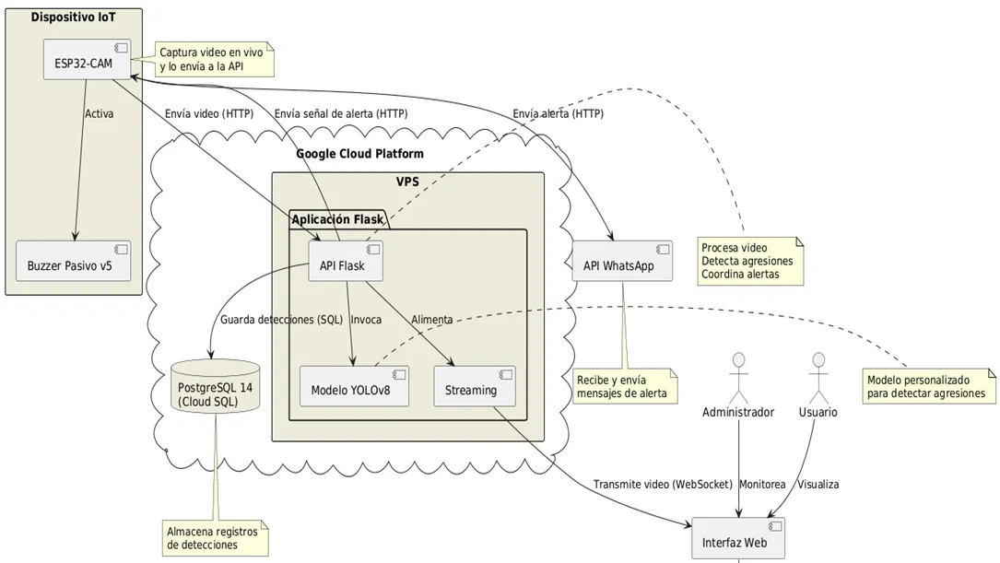
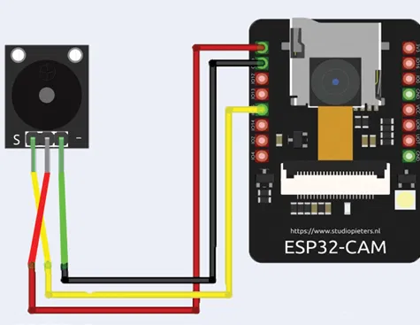
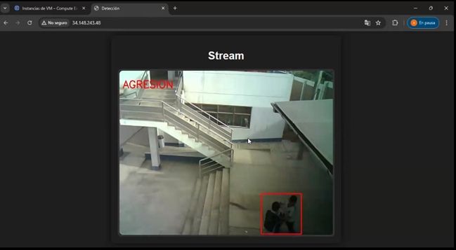
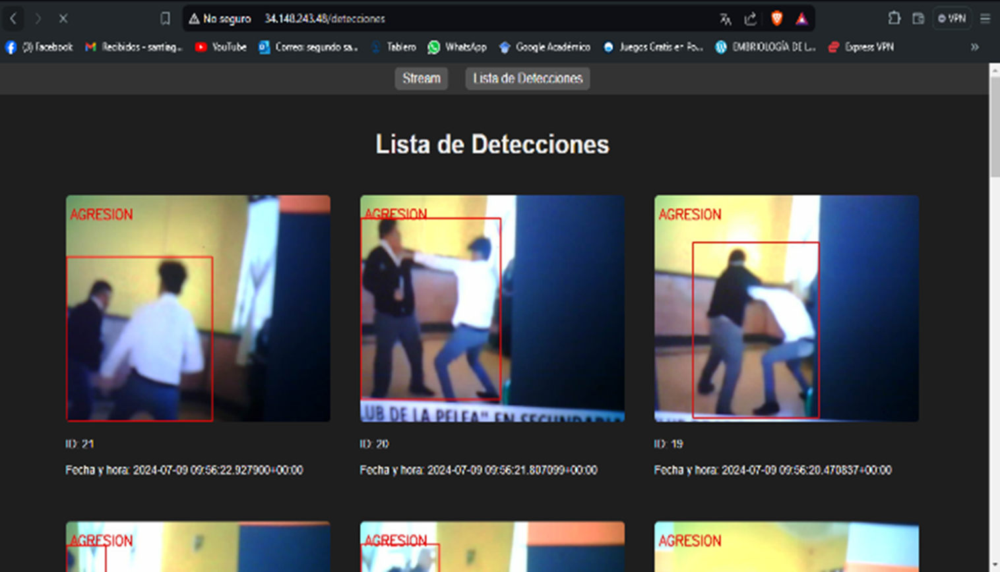

## Tecnologías utilizadas

- **Hardware:** ESP32-CAM, buzzer.
- **Backend:** Python, Flask.
- **Inteligencia artificial:** YOLOv8, OpenCV.
- **Base de datos:** PostgreSQL.
- **Infraestructura:** Google Cloud Platform.
- **Comunicación:** HTTP, WebSocket.
- **Notificaciones:** API de WhatsApp.

## Arquitectura del sistema

## Circuito IoT

## Capturas del sistema

### Detección de agresiones

### Historial de detecciones

## Instalación

### Requisitos previos

- Python compatible con las dependencias del proyecto.
- PostgreSQL, si no utilizas una instancia remota.
- Git.

### Pasos de instalacion
- cd  IoT-DeteccionDePeleas
- python -m venv venv
- venv\Scripts\activate            # Windows
- pip install -r requirements.txt
- python app.py

### Configura las variables de entorno y la conexión a PostgreSQL según la configuración del proyecto.

- Ejecuta la aplicación siguiendo las instrucciones de inicio de cada componente.

> Los comandos de ejecución y la configuración de la base de datos deben ajustarse a la estructura real del proyecto. cual duda con la bd y las alertas en el .env
